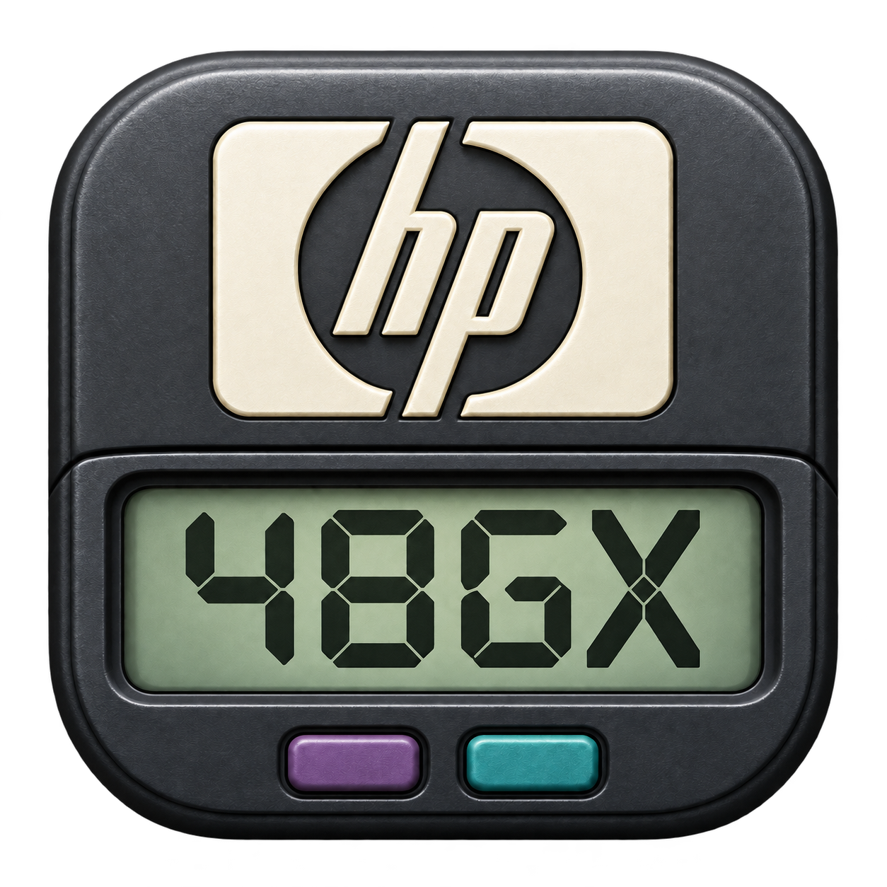
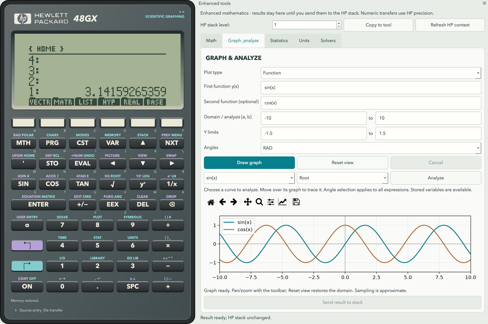

# HP 48GX Desktop



One HP-style calculator, powered by original HP firmware, with enhanced Python mathematics in a closable side panel. The interface uses **Qt6 / PySide6**. A separate x48ng Saturn core runs the ROM; SymPy, SciPy and Matplotlib power the enhanced tools.

The ROM handles the calculator keypad, stack, variables, HP commands, UserRPL/System RPL, menus and native graphics. Enhanced calculations are explicit tool operations; they do not replace ROM command behavior or introduce a second calculator window.


## Run

Requires Python 3.10 or newer and a C compiler for source installations.

```sh
python3 -m venv .venv
source .venv/bin/activate
python -m pip install -e '.[dev]'
python -m hp48g
```

On Windows, activate with `.venv\Scripts\activate`. On macOS, `Launch.command` starts the same calculator after setup. The installed `hp48g` command also opens it. macOS source launches use a small generated `build/HP 48GX Calculator.app` bundle so the Dock and task switcher show the calculator name; this bundle uses the current source and virtual environment. The previous `--rom` argument remains accepted, but is no longer needed. Use `--rom-directory PATH` to select another profile.

Choose **File → Download ROM revision…** or **Use local HP48 ROM…**. Supported firmware is HP 48GX K/L/M/P/R and HP 48SX J. ROMs are downloaded separately and are never included in packages. Source installations need macOS Command Line Tools, Linux GCC/Clang, or Windows MinGW GCC; standalone packages include the compiled core.

The tested dependency versions are recorded in `requirements-lock.txt` (macOS, Python 3.12). See the [calculator guide](docs/original-calculator.md) for ROM setup and desktop tools.

## Using the calculator

The calculator face uses an HP-style case, recessed green LCD, Hewlett-Packard logo and purple/teal shift legends. Key sizes remain stable when shift modes change. The face fits without scrollbars and compacts on smaller screens.

Click the LCD's six bottom menu labels or use A–F. Framed choice menus, including SOLVE, SYMBOLIC, TIME, STAT and UserRPL CHOOSE, support clicking an option to select and confirm it. Use the mouse wheel to browse longer lists. **Source entry & file transfer** expands the ROM source editor beneath the keypad; its open/closed state persists.

On macOS, the application menu and task-switcher name are **HP 48GX Calculator**. **File** contains profile selection, local ROM loading, ROM downloads, HP source loading and keyboard help.

## Enhanced tools

Choose **Tools → Enhanced tools** to open the side panel in the calculator window. Close the panel to return to the calculator face alone. There is no separate Python calculator or mode-switching workflow.



- **Math:** exact symbolic calculations, derivatives, integrals, solving, simplification, matrices, vectors and complex arithmetic. Enter an enhanced RPN calculation; its results appear in the tool, leaving the HP stack unchanged.
- **Graph & Analyze:** multiple functions, polar and parametric curves, implicit contours, 3D surfaces, slope fields, histograms and scatter plots. Includes pan/zoom, image export, roots, intersections, integration, extrema, derivatives and value tables.
- **Statistics:** descriptive statistics and paired-data linear regression.
- **Units:** common length, mass, time, temperature, pressure, energy, volume and angle conversions.
- **Solvers:** first-order differential equations, time-value-of-money finance and probability distributions.

Use **Refresh HP context** to read the calculator's angle mode and numeric variables in the current directory. Refresh after changing them on the calculator. Graphs also offer explicit RAD/DEG/GRAD overrides.

Select an **HP stack level** and choose **Copy to tool** to read a supported value without removing it. The Statistics and Units tabs receive suitable data directly; other tabs send the copied value to Math for inspection. Native objects that cannot be inspected stay on the HP calculator and remain accessible through its ROM tools.

Choose **Send result to stack** (or **Send selected result to HP stack** in Math) to append a compatible result to the HP stack. Existing stack entries are preserved. Numbers use HP's 12-digit precision and range; exact Python results remain available in the tools. Transfers support finite numbers, complex numbers, lists, numeric matrices, strings and basic arithmetic algebraics. Unsupported exact objects and oversized values remain on the host; the app reports the limitation instead of replacing the result or clearing the stack.

### Enhanced Math examples

| Input | Operation |
|---|---|
| `'x^3-2*x' x DIFF` | Differentiate with respect to x |
| `'x^2' x 0 3 DINT` | Definite integral |
| `'x^2-2' x SOLVE` | Symbolic roots |
| `RAD 'cos(x)-x' x 1 ROOT` | Numerical root near 1 |
| `[[2,0],[0,4]] [6,8] LSOLVE` | Solve a linear system |
| `[1,2,3] [4,5,6] DOT` | Vector dot product |

These examples use the Python math engine's syntax. Use the calculator keypad or **Source entry & file transfer** for original HP programs and commands. The [enhanced UserRPL reference](docs/rpl-compatibility.md) describes the Python engine's subset; it does not limit the ROM calculator.

Each enhanced calculation starts with its entered arguments and the refreshed numeric context, rather than a second persistent stack. Results are selected for explicit transfer. Long Python calculations run in cancellable workers with a 30-second timeout.

For multiple graphs, enter a second function in the optional field or separate more curves with semicolons. Select a curve for analysis and a second curve for intersections. Inputs and axis views persist by plot type. Adding curves retains the view. Roots/intersections require a sign-changing bracket; detected discontinuities are rejected. Bounded extrema are not certified global extrema, and finite sampling can miss small features.

## Memory and saved work

**Tools → Memory cards → Expand working memory to 256 KB** merges a GX's built-in RAM and port 1. **Enable 4 MB storage card** expands port 2 while retaining its objects. Configuration and contents persist in the profile checkpoint. Expansion creates a recovery backup.

The card provides 3,968 KB of ROM-accessible object storage through ports 2–32, separate from the 256 KB working memory. For example, `123 :2:VALUE STO` stores an object and `:2:VALUE RCL` recalls it. These GX shortcuts do not apply to SX profiles. See the [memory guide](docs/original-calculator.md#setup).

Saved data lives in a per-user `hp48gx` directory: `~/Library/Application Support/hp48gx` on macOS, `%LOCALAPPDATA%/hp48gx` on Windows, and `$XDG_DATA_HOME/hp48gx` (normally `~/.local/share/hp48gx`) on Linux. The default calculator profile is its `original-hp48` subdirectory. Existing `HP48G Desktop` data is copied on first launch after the old calculator closes; the old directory is retained as a recovery copy, and existing new data is never overwritten. Explicitly selected custom ROM profiles stay in their chosen locations. ROM memory is saved periodically and on normal exit. Enhanced inputs, graph settings, solver settings and Math results are saved separately as `enhanced-tools.json` inside the same profile. Python tools can retain results larger or more exact than the ROM can represent.

On first opening Enhanced tools, an existing `HP48G Desktop/workspace.json` from the former Python calculator is read to recover tool inputs and saved stack/variable values. Recovered values appear as Math results for explicit transfer. The old file remains untouched; this migration does not overwrite HP memory. Previous Python programs and other unsupported results remain in that original file.

## Other desktop tools

The **Tools**, **Clipboard** and **Sound** menus provide ROM graph interaction and analysis, a source editor/debugger, memory browsing, rolling and named backups, memory cards, clipboard transfer, ROM beep/alarm audio and reminders. Source stepping, breakpoints and watches remain available. Background operation, start-at-login and OS wake requests are optional; wake behavior depends on hardware and permissions.

Graph Tools works on the ROM's PICT and PPAR data. Enhanced Graph & Analyze computes with Python and transfers selected results explicitly. They serve different operations within the same application. See the [calculator guide](docs/original-calculator.md) for scope and debugger limitations.

## Compatibility and platforms

Original commands and native object behavior remain implemented by HP firmware. Serial and infrared connections are excluded. Instruction pacing is available, but cycle-exact timing is not guaranteed. Python enhancements use different numerical methods and are never silently substituted for ROM operations.

The macOS app has been locally tested; the Windows core has been cross-compiled. Native Windows and Linux package/runtime verification remains required before declaring those releases verified. The x48ng core retains its GPL license; see [provenance and modifications](hp48g/native/x48ng/UPSTREAM.md).

## Tests

```sh
python -m pytest -q
```

For headless Qt tests, set `QT_QPA_PLATFORM=offscreen`. Native ROM tests require local firmware and skip when it is unavailable. To download checksum-verified fixtures and run the full suite on macOS/Linux:

```sh
python scripts/download_test_roms.py
HP48G_TEST_ROM=.rom/rom QT_QPA_PLATFORM=offscreen python -m pytest -q
```

On Windows, set the environment variables in your shell first. Fixtures are ignored by Git and excluded from packages. Tests cover the ROM, enhanced calculations, stack transfer, persistence and desktop tools; they do not certify every HP command or cycle-accurate behavior.

## Standalone packages

```sh
python -m pip install -e '.[dev,packaging]'
python scripts/build_desktop.py --archive
```

The application includes a shared HP/48GX icon for windows, the macOS Dock, task switchers and the tray. Builds embed `.icns` artwork on macOS and a multi-size `.ico` on Windows. See [icon assets](hp48g/assets/README.md) for regeneration instructions.

Build on the target OS. Outputs in `dist/` are a macOS app/DMG, Windows portable ZIP or Linux tarball. Packages include Python, Qt, the core, native source and license notices; users download firmware separately. macOS packages are locally signed but not Apple-notarized; Windows packages are unsigned.

The [build workflow](.github/workflows/desktop.yml) runs tests and creates artifacts on macOS, Linux and Windows when manually dispatched or when a `v*` tag is pushed. It does not publish a release automatically. See [packaging details](docs/original-calculator.md#building-desktop-packages).
