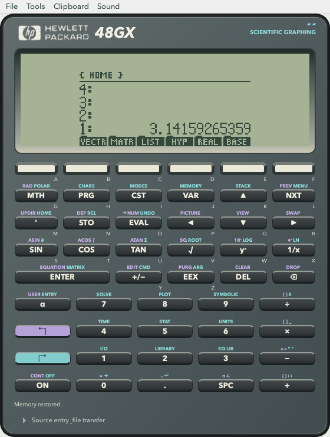
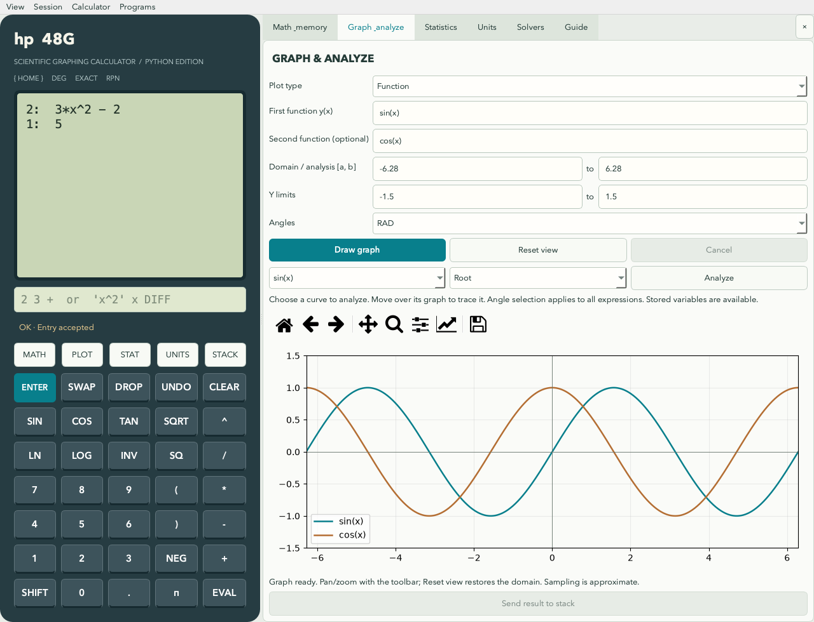

# HP 48G Desktop

A Python / Qt6 desktop calculator with two modes:

- **Original HP calculator** runs HP 48GX or HP 48SX firmware on a Saturn emulator, with original commands, UserRPL/System RPL, LCD menus and graphics, plus desktop tools for programs, graphs, backups, memory cards and alarms.
- **Enhanced Python workspace** provides a scrollable RPN stack, exact symbolic mathematics, a command browser and interactive desktop graphing. Its UserRPL support is a subset of the original calculator.

The interface uses **PySide6**. The enhanced workspace uses SymPy, SciPy and Matplotlib; original mode uses a separate x48ng native core and a separately downloaded HP ROM. Each mode has independent memory.

## Run

Requires Python 3.10 or newer.

```sh
python3 -m venv .venv
source .venv/bin/activate
python -m pip install -e '.[dev]'
python -m hp48g
```

On Windows, activate the environment with `.venv\Scripts\activate` instead.
On macOS, double-click `Launch.command` after setup to open the enhanced workspace.

To open the original calculator directly:

```sh
python -m hp48g --rom
```

Choose **File → Download ROM revision…** on first use, or select a supported local ROM. Supported firmware is HP 48GX K/L/M/P/R and HP 48SX J. Source installations need a C compiler for this mode (macOS Command Line Tools, Linux GCC/Clang, or Windows MinGW GCC). Standalone packages include the compiled core. See the [original calculator guide](docs/original-calculator.md) for setup and desktop tools.

After installation, `hp48g` is also available as an application command. In this workspace dependencies are already installed in `.venv`; launch with `.venv/bin/python -m hp48g`.

The tested dependency versions are recorded in `requirements-lock.txt` (macOS, Python 3.12).

## Original HP calculator

The original-mode face follows the HP 48GX layout, with a charcoal case,
recessed green LCD, blended Hewlett-Packard logo, and purple/teal shift legends.
Shifted labels fit within the same key sizes. The complete calculator fits the
window without scrollbars, with a more compact layout on smaller screens.



Click the LCD's six bottom menu labels or use the A–F keys. Framed choice menus,
including SOLVE, SYMBOLIC, TIME, STAT and UserRPL CHOOSE, also support clicking
an option to select and confirm it; use the mouse wheel to browse longer lists.
**Source entry & file transfer** expands the editor below the keypad, and its
open/closed state persists across launches.

On macOS, the application menu is named **HP-48GX**. The **File** menu provides
**Open another ROM profile…**, **Use local HP48 ROM…**, **Download ROM revision…**,
**Load HP source…**, and **Keyboard help**, in that order. Saved profiles remain
in the existing `HP48G Desktop` application-data directory.

For expanded memory, choose **Tools → Memory cards → Expand working memory to
256 KB** or **Enable 4 MB storage card**. These GX settings and card contents
persist across launches. The card provides 3,968 KB of ROM-accessible object
storage, separate from the 256 KB working memory. Expansion retains existing
card objects and creates a recovery backup. See the [memory setup guide](docs/original-calculator.md#setup)
for capacity limits, backups and storage examples.

## Using the enhanced Python workspace



Enter `2 3 +` and press Enter, or enter each number separately and click `+`. Empty Enter duplicates the top of the stack. Input can contain a whole RPN sequence; operations consume their arguments from the stack in left-to-right order. Failed or cancelled sequences leave stack, variables, and modes unchanged. Undo retains up to 100 prior states. Calculations run in cancellable background processes with a 30-second timeout. Click **Cancel calculation** to stop a calculation while keeping its input.

Use **STACK** to browse every stack level, copy a value to the top, move it, edit it, or delete it. `n PICK` copies stack level n; `n ROLL` moves it to the top. The main display also scrolls through the entire stack.

- Scientific: degree/radian/gradian trigonometry, inverse and hyperbolic functions, logarithms, powers, factorials, combinations, permutations, percentages, complex arithmetic, binary-integer arithmetic and logic with adjustable word size.
- Symbolic: derivatives, indefinite and definite integrals, equation solving, numerical roots, substitution, simplification, expansion, factorization, exact and decimal display.
- Linear algebra: matrices, determinant, inverse, transpose, rank, trace, eigenvalues, linear systems, vector dot/cross products and norms. Bracketed vectors use elementwise addition/subtraction and scalar multiplication/division; two-vector multiplication requires DOT or CROSS. Eigenvalues include multiplicities.
- Data: mean, median, sample variance/deviation, sorting, sums, paired-data linear regression and correlation.
- Graphs: multiple functions, polar, parametric, implicit zero contours, 3D surfaces, slope fields, histograms and scatter plots. Pan, zoom and image export are in the plot toolbar. Each plot type retains its inputs and axis limits. Set y limits directly or use the toolbar; Reset view restores the domain. Function sampling refines curved segments and splits detected poles, but remains a bounded numerical approximation.
- Analysis: selected-curve bracketed roots, intersections, numerical integration, bounded extrema (including endpoints), derivatives, values, and a 21-point value table. Moving over a function displays sampled trace coordinates.
- Solvers: first-order differential equations with initial conditions, end-of-period time-value-of-money cash flows, normal/Student t/chi-square/binomial/Poisson density, cumulative and inverse probabilities.
- Programs and memory: structured UserRPL with branches, loops, local variables and error handling; source editing; named variables and directories; complete workspace JSON save/load and automatic desktop restore. See the [UserRPL compatibility guide](docs/rpl-compatibility.md) for supported syntax and differences.
- Units: conversions for common length, mass, time, temperature, pressure, energy, volume and angle units.

### Examples

| Input | Operation |
|---|---|
| `'x^3-2*x' x DIFF` | Differentiate with respect to x |
| `'x^2' x 0 3 DINT` | Integrate from 0 to 3 |
| `'x^2-2' x SOLVE` | Symbolic roots |
| `RAD 'cos(x)-x' x 1 ROOT` | Numerical root near 1 |
| `[[2,0],[0,4]] [6,8] LSOLVE` | Solve A·x = b |
| `42 'a' STO` then `a` | Store and recall |
| `« DUP * » 'square' STO` then `7 square` | Store and run a program |

Arguments to `SUBST` are expression and `[symbol,value]`; `DINT` takes expression, symbol, lower, upper; `ROOT` takes expression, symbol, guess. The command browser lists every registered calculation command. Stack and memory commands are described in the Guide tab. HP lists use `{ 1 2 3 }`; vectors accept `[1 2 3]` or the existing `[1,2,3]` syntax. Single-letter names remain convenient symbolic variables. Unknown longer names report an error with a command suggestion. Quote a new symbolic name, for example `'velocity'`; stored variables can then be recalled without quotes. Command names cannot be overwritten by STO.

Typed trig expressions and keypad trig both follow DEG/RAD/GRAD. For example, `DEG sin(90)` and `DEG 90 SIN` both produce 1. Quoted expressions capture the angle convention when entered.

Graph angles default to the calculator setting, with explicit RAD/DEG/GRAD overrides in the graph panel. Polar/parametric examples default to RAD. Stored scalar variables are available in graph expressions; the plot's independent variables (`x`, `y`, or `t`) override memory values with those names. Each mode retains its own expressions, domain and view when switching modes. Invalid graph input preserves the previous graph. Adding curves retains the view; changing a function domain updates x while preserving y.

Enter a second function in the optional field, or separate more curves with semicolons. Choose a curve in the analysis selector; Intersection uses the second curve selector as well. The domain supplies the analysis interval. Roots and intersections need a sign-changing bracket; detected discontinuities are rejected. Bounded extrema include endpoints but are not certified global extrema for multimodal functions. Sampling can still miss features smaller than its resolution.

**Send result to stack** transfers graph analysis, unit conversion, finance, probability and ODE results into the RPN stack. Statistics offers a selector for the input data, summary statistics or regression coefficients. Transferred results can be stored with `'name' STO`, used in calculations and undone.

## Saving and restoring the enhanced workspace

Session version 2 saves exact structured mathematical values, including unevaluated integrals, derivatives, piecewise expressions and algebraic roots. It also saves UserRPL lists, strings, binary integers, tagged objects, user flags, binary modes, directory trees/current path, program-editor drafts, graph inputs/views for each mode, statistics data/results, solver inputs/results, unit settings, unfinished entry text and panel layout. Version 1 calculator sessions remain readable, including older unevaluated-integral values. Files are validated before the current workspace changes, and saves use atomic replacement.

The desktop launcher automatically saves the workspace to Qt's application-data directory and restores it on launch. On macOS this is normally `~/Library/Application Support/HP48G Desktop/workspace.json`. Session → Save creates a separate portable JSON file. Opening another file prompts to save unsaved changes. Closing saves the automatic workspace; if that fails, the app asks before discarding work. Automatic saving does not overwrite a manually saved session file.


## Compatibility boundary

The application has two calculator modes. **Calculator → Original HP 48GX (ROM)**
runs original HP 48GX (K/L/M/P/R) or HP 48SX (J) firmware on a Saturn emulator, with the HP command
set, UserRPL/System RPL, native binary objects, menus and original graphics.
The Python/PySide6 window provides keyboard input, file transfer and saved memory.
See [original-calculator setup and usage](docs/original-calculator.md).

The **enhanced Python workspace** provides exact symbolic arithmetic and desktop
graphing tools. Its UserRPL interpreter has a smaller command set and different
numeric behavior; its compatibility inventory applies only to that mode.
See [enhanced UserRPL examples and limits](docs/rpl-compatibility.md).

Original mode requires a separately downloaded, checksum-verified HP ROM.
Standalone packages include Python, Qt and the core; source builds need a C
compiler. Serial/infrared are excluded. Instruction pacing is available, but
cycle-exact timing is not guaranteed. The macOS app has been locally tested; the Windows core
has been cross-compiled. Native Windows and Linux package/runtime verification
are provided for by the CI workflow and remain required before declaring those releases verified.
The separate x48ng core retains its GPL license; see
[provenance and modifications](hp48g/native/x48ng/UPSTREAM.md).

Original mode also includes ROM beep/alarm audio, rolling and named backups,
clipboard transfer, a source editor/debugger, a memory browser, and mouse-driven
graph tools. Open the **Tools**, **Clipboard**, and **Sound** menus.

Additional original-mode tools include source stepping and breakpoints, local
and global watches, memory-card management, multiple graph expressions and
ROM-based curve analysis, persistent reminders, optional background operation,
start-at-login and OS wake requests. Wake behavior depends on hardware and OS
permissions. See the original-calculator usage guide for scope, platform validation and debugger limitations.

## Tests

```sh
python -m pytest -q
```

For headless Qt tests, set `QT_QPA_PLATFORM=offscreen`. Native ROM tests require a local ROM; without it those tests explicitly skip. To download the six checksum-verified fixtures and run the full suite on macOS/Linux:

```sh
python scripts/download_test_roms.py
HP48G_TEST_ROM=.rom/rom QT_QPA_PLATFORM=offscreen python -m pytest -q
```

On Windows, set those environment variables in your shell before running pytest. ROM fixtures are ignored by Git and excluded from packages. Tests cover both calculator modes, persistence, desktop tools and representative ROM behavior; they do not certify every HP command or cycle-accurate hardware behavior.

## Standalone desktop packages

```sh
python -m pip install -e '.[dev,packaging]'
python scripts/build_desktop.py --archive
```

Build on the target operating system. Outputs in `dist/` are a macOS app/DMG, a Windows portable ZIP, or a Linux tarball. Packages include Python, Qt, the compiled core, native source and license notices; users download their ROM separately. The macOS package is locally signed but not Apple-notarized, and Windows packages are unsigned.

The [desktop build workflow](.github/workflows/desktop.yml) runs tests and creates artifacts on macOS, Linux and Windows when manually dispatched or when a `v*` tag is pushed. It does not publish a release automatically. See [packaging details](docs/original-calculator.md#building-desktop-packages).
